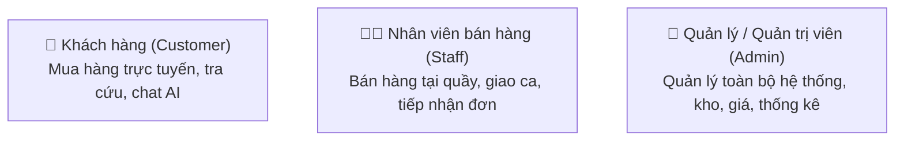
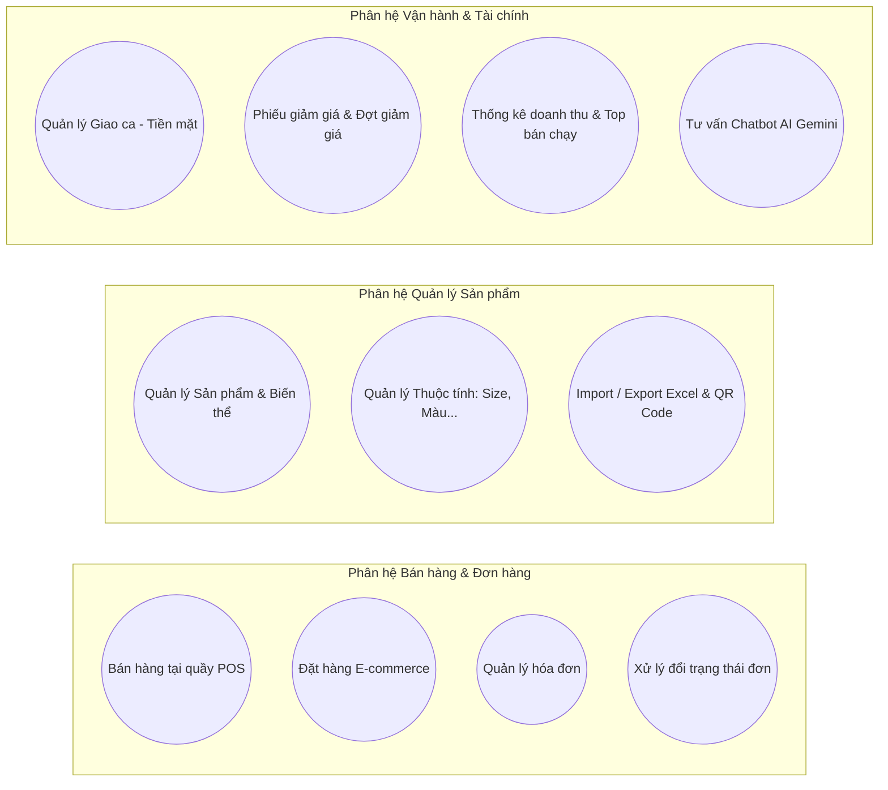
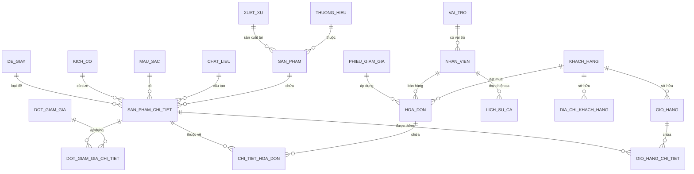
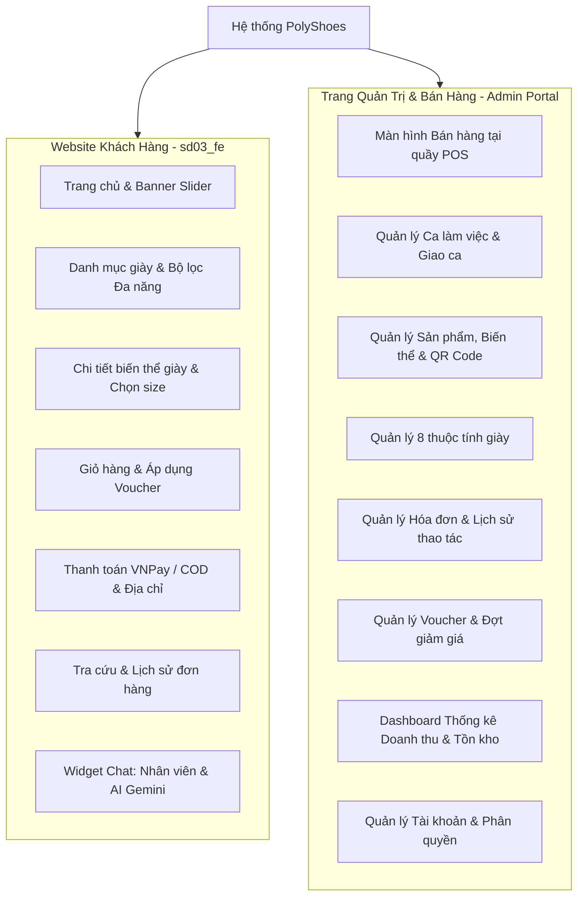

# BÁO CÁO DỰ ÁN TỐT NGHIỆP
# ĐỀ TÀI: XÂY DỰNG HỆ THỐNG WEBSITE VÀ QUẢN LÝ BÁN GIÀY THỂ THAO POLYSHOES

---

* **Đơn vị đào tạo:** TRƯỜNG CAO ĐẲNG FPT POLYTECHNIC
* **Bộ môn:** Ứng dụng Phần mềm / Công nghệ Thông tin
* **Chuyên ngành:** Phát triển phần mềm
* **Nhóm thực hiện:** SD-03 (PolyShoes)
* **Hệ thống phát triển:** Hệ thống quản lý bán hàng đa kênh (Omni-channel E-Commerce & POS) PolyShoes
* **Thời gian thực hiện:** 2025 – 2026

---

## THEO DÕI PHIÊN BẢN TÀI LIỆU

| Tên tài liệu | Ngày | Lý do thay đổi | Phiên bản | Người cập nhật |
| :--- | :---: | :--- | :---: | :--- |
| Báo cáo Dự án Tốt nghiệp PolyShoes | 01/10/2025 | Khởi tạo đề cương dự án | 0.1 | Nhóm SD-03 |
| Báo cáo Dự án Tốt nghiệp PolyShoes | 15/11/2025 | Cập nhật phân tích Use Case & ERD | 0.5 | Nhóm SD-03 |
| Báo cáo Dự án Tốt nghiệp PolyShoes | 20/01/2026 | Cập nhật luồng Giao ca & POS Sales | 0.8 | Nhóm SD-03 |
| Báo cáo Dự án Tốt nghiệp PolyShoes | 09/03/2026 | Hoàn thiện đặc tả, kiểm thử & nghiệm thu | 1.0 | Nhóm SD-03 |

---

## DANH SÁCH THÀNH VIÊN VÀ PHÂN CÔNG TRÁCH NHIỆM

| STT | Họ và tên | Mã sinh viên | Vai trò | Chuyên trách nghiệp vụ |
| :---: | :--- | :---: | :--- | :--- |
| 1 | Phạm Vũ Hoàng Anh | PH47172 | **Trưởng nhóm (Team Leader)** | Kiến trúc hệ thống, Module POS, Quản lý Hóa đơn & Giao ca |
| 2 | Thành viên Backend 1 | PH47xxx | **Backend Developer** | Quản lý Sản phẩm, Biến thể giày, Đợt giảm giá & Voucher |
| 3 | Thành viên Backend 2 | PH47xxx | **Backend Developer** | Quản lý Khách hàng, Nhân viên, Phân quyền `QuyenGuard` & Chatbot AI |
| 4 | Thành viên Frontend 1 | PH47xxx | **Frontend Developer** | Giao diện Bán hàng tại quầy (POS), Quản lý Kho & Thuộc tính |
| 5 | Thành viên Frontend 2 | PH47xxx | **Frontend / QA Tester** | Giao diện Khách hàng (E-commerce), Giỏ hàng, Thanh toán & Kiểm thử |

---

## LỜI CẢM ƠN

Lời đầu tiên, nhóm phát triển dự án **PolyShoes (SD-03)** xin được gửi lời tri ân chân thành và sâu sắc nhất đến toàn thể quý Thầy, Cô giáo bộ môn Phát triển phần mềm – Trường Cao đẳng FPT Polytechnic. Trong suốt quá trình học tập và rèn luyện tại trường, quý Thầy Cô không chỉ trang bị cho chúng em nền tảng kiến thức chuyên môn vững chắc về lập trình Java, kiến trúc hướng đối tượng, cơ sở dữ liệu và công nghệ web hiện đại, mà còn truyền lửa nhiệt huyết, phương pháp tư duy giải quyết vấn đề và đạo đức nghề nghiệp.

Đặc biệt, nhóm chúng em xin trân trọng cảm ơn Giảng viên hướng dẫn dự án tốt nghiệp. Sự chỉ bảo tận tình, những buổi review phản biện chuyên môn sâu sắc cùng những định hướng thực tế của Thầy/Cô đã giúp nhóm tháo gỡ nhiều bài toán phức tạp về nghiệp vụ bán lẻ đa kênh, tối ưu cơ sở dữ liệu và bảo mật hệ thống.

Chúng em cũng xin gửi lời cảm ơn đến gia đình và bạn bè đã luôn động viên, hỗ trợ tinh thần để nhóm vượt qua các áp lực kỹ thuật và hoàn thành xuất sắc đồ án tốt nghiệp này.

---

## TÓM TẮT NỘI DUNG DỰ ÁN

Trong thời đại chuyển đổi số và thương mại điện tử phát triển bùng nổ, mặt hàng **giày thể thao (Sneakers)** luôn là phân khúc có nhu cầu cực lớn từ giới trẻ và người tiêu dùng yêu thích phong cách sống năng động. Tuy nhiên, các cửa hàng bán lẻ giày dép hiện nay thường gặp thách thức lớn trong việc:
1. **Quản lý biến thể phức tạp:** Một đôi giày bao gồm nhiều thuộc tính kích cỡ (Size 35–45), màu sắc, chất liệu, loại đế, kiểu dáng và thương hiệu. Quản lý thủ công dẫn đến tồn kho ảo và sai lệch số lượng.
2. **Đồng bộ đa kênh (Omni-channel):** Khách mua tại quầy (POS) và khách đặt online trên website cạnh tranh cùng một lượng hàng tồn kho vật lý. Nếu không đồng bộ tức thời, nguy cơ bán vượt tồn kho (overselling) là rất cao.
3. **Quản lý doanh thu và ca làm việc:** Nhân viên bán hàng theo ca thu tiền mặt và tiền chuyển khoản. Rủi ro thất thoát tài chính, chênh lệch quỹ tiền mặt đầu ca/cuối ca rất dễ phát sinh nếu thiếu quy trình **Giao ca (Shift Handover)** chặt chẽ.
4. **Khuyến mãi linh hoạt:** Cần hỗ trợ song song cả **Phiếu giảm giá (Voucher)** áp dụng trên hóa đơn và **Đợt giảm giá (Campaign)** giảm giá trực tiếp theo từng biến thể sản phẩm.

Dự án **“Xây dựng Website và Quản lý Bán giày Thể thao PolyShoes”** của nhóm **SD-03** ra đời nhằm giải quyết triệt để các bài toán trên. Hệ thống là giải pháp khép kín toàn diện gồm 2 phân hệ chính:
* **Phân hệ Khách hàng (Client E-Commerce):** Giúp người mua dễ dàng tra cứu, lọc giày theo size, màu sắc, hãng sản xuất; quản lý giỏ hàng; thanh toán trực tuyến qua VNPAY / COD; tích hợp Chatbot AI hỗ trợ tư vấn chọn mẫu giày và kích cỡ theo ngữ cảnh.
* **Phân hệ Quản trị & Bán hàng tại quầy (Admin & POS):** Giao diện bán hàng tốc độ cao, hỗ trợ quét mã vạch/QR sản phẩm, tạo hóa đơn chờ, tính phí ship tự động (kết nối GHN), quản lý sổ giao ca minh bạch và hệ thống báo cáo thống kê trực quan.

---

## QUY ƯỚC TÀI LIỆU VÀ CHÚ GIẢI THUẬT NGỮ

### 1. Quy ước tài liệu
* **Font chữ chính:** Times New Roman hoặc Arial.
* **Cỡ chữ:** Tiêu đề cấp 1 (18pt, In đậm), Tiêu đề cấp 2 (14pt, In đậm), Nội dung thường (12pt), Bảng biểu / Chú thích (10–11pt).
* **Mã nguồn / API:** Định dạng `Monospace` (Code block).

### 2. Chú giải thuật ngữ
* **POS (Point of Sale):** Điểm bán hàng / Màn hình bán hàng trực tiếp tại quầy thu ngân.
* **SKU / Biến thể (Product Variant):** Sản phẩm chi tiết tạo bởi tổ hợp các thuộc tính (ví dụ: Giày Nike Air Force 1 - Size 41 - Màu Trắng).
* **Voucher / Phiếu giảm giá:** Mã giảm giá áp dụng trên tổng tiền của hóa đơn.
* **Đợt giảm giá (Flash sale / Campaign):** Giảm giá trực tiếp theo % hoặc tiền cố định vào giá bán gốc của từng biến thể giày.
* **Giao ca (Shift Handover):** Nghiệp vụ bàn giao trách nhiệm quản lý quỹ tiền mặt giữa nhân viên ca trước và ca sau.
* **RBAC (Role-Based Access Control):** Kiểm soát truy cập dựa trên vai trò người dùng (`ADMIN`, `STAFF`, `CUSTOMER`).
* **JWT (JSON Web Token):** Chuẩn mã hóa token xác thực người dùng trong kiến trúc stateless REST API.

---

# PHẦN 1: TỔNG QUAN VÀ GIỚI THIỆU ĐỀ TÀI

## 1. Bối cảnh hiện trạng
Ngành kinh doanh giày thể thao tại Việt Nam đang chứng kiến sự tăng trưởng vượt bậc với hàng trăm thương hiệu từ quốc tế (Nike, Adidas, Puma, New Balance) đến thương hiệu nội địa. Tuy nhiên, phần lớn các cửa hàng vừa và nhỏ vẫn quản lý qua sổ sách hoặc bảng tính Excel rời rạc. Điều này dẫn đến các hạn chế cốt tử:
* Không kiểm soát được số lượng tồn theo từng size/màu cụ thể.
* Khách đến quầy hỏi mẫu nhưng nhân viên phải vào kho lục tìm mất 10–15 phút.
* Không có cơ chế lưu lịch sử đơn hàng và tích lũy tri ân cho khách quen.
* Thất thoát tiền mặt khi đổi ca giữa các nhân viên thu ngân.

## 2. Mục tiêu của đề tài
1. **Đối với Khách hàng:** Cung cấp trải nghiệm mua sắm mượt mà, tìm kiếm nhanh, gợi ý sản phẩm thông minh qua AI, đặt hàng chỉ với 3 bước.
2. **Đối với Nhân viên:** Tối ưu hóa tốc độ tạo hóa đơn tại quầy dưới 30 giây; tích hợp máy quét mã vạch/QR; hỗ trợ thanh toán đa hình thức (Tiền mặt, VNPay QR, Chuyển khoản); quản lý bàn giao ca chính xác từng đồng.
3. **Đối với Quản lý / Chủ cửa hàng:** Kiểm soát hàng tồn kho đa chiều; phân quyền chặt chẽ; thiết lập chiến dịch khuyến mãi linh hoạt; theo dõi biểu đồ tăng trưởng doanh thu theo ngày/tuần/tháng/năm theo thời gian thực.

## 3. Phạm vi đề tài
* **Phạm vi nghiệp vụ:** Bán hàng tại quầy (In-store POS), Bán hàng online (E-commerce), Quản lý kho sản phẩm & biến thể, Quản lý khuyến mại (Voucher & Campaign), Quản lý ca làm & lịch sử giao ca, Thống kê báo cáo, Tư vấn trực tuyến (Staff Chat & Gemini AI Chat).
* **Phạm vi kỹ thuật:**
  * Backend: Java 17, Spring Boot 3, Spring Security + JJWT, Spring Data JPA, MS SQL Server.
  * Frontend: Vue 3 (Composition API `<script setup>`), Vite, Bootstrap 5, Axios, Pinia/LocalStorage, QRCode, ExcelJS.

## 4. Phương pháp phát triển phần mềm
Dự án áp dụng mô hình **Agile / Scrum kết hợp nguyên lý phát triển linh hoạt**:
* Phân chia dự án thành các Sprint (mỗi Sprint 2 tuần).
* Đánh giá và kiểm thử liên tục (Continuous Testing) sau mỗi module hoàn thiện.
* Giữ cấu trúc thiết kế tinh gọn, tránh over-engineering, ưu tiên tính ổn định và tương thích cao.

---

# PHẦN 2: PHÂN TÍCH YÊU CẦU VÀ HỆ THỐNG

## 1. Yêu cầu người dùng (User Stories)

| STT | Tác nhân | Tôi muốn... | Để... |
| :---: | :--- | :--- | :--- |
| US-01 | Khách hàng | Tìm kiếm giày theo tên, lọc theo khoảng giá, size, màu sắc, hãng sản xuất | Nhanh chóng tìm được đôi giày đúng kích cỡ và sở thích |
| US-02 | Khách hàng | Thêm sản phẩm vào giỏ hàng và đặt hàng trực tuyến | Mua hàng từ xa mà không cần đến cửa hàng |
| US-03 | Khách hàng | Chọn phương thức thanh toán VNPay hoặc COD khi nhận hàng | Linh hoạt trong việc thanh toán giao dịch |
| US-04 | Khách hàng | Chat hỏi thông tin giày với nhân viên hoặc trợ lý AI | Được tư vấn chọn size chuẩn xác ngay lập tức |
| US-05 | Khách hàng | Tra cứu trạng thái đơn hàng qua mã vận đơn | Biết thời gian dự kiến đơn hàng được giao tới nơi |
| US-06 | Nhân viên | Tạo nhanh hóa đơn chờ tại quầy và quét mã QR/Barcode sản phẩm | Phục vụ nhiều khách hàng cùng lúc mà không bị nhầm lẫn |
| US-07 | Nhân viên | Mở ca làm việc, khai báo tiền đầu ca và kết ca bàn giao tiền mặt | Minh bạch tài chính, tránh đền bù chênh lệch tiền mặt |
| US-08 | Nhân viên | Tìm kiếm thông tin khách hàng bằng số điện thoại để tích điểm / áp voucher | Chăm sóc và giữ chân khách hàng thân thiết |
| US-09 | Quản lý | Quản lý danh mục sản phẩm, biến thể giày chi tiết và import/export Excel | Cập nhật kho hàng nhanh chóng khi nhập lô hàng mới |
| US-10 | Quản lý | Tạo phiếu giảm giá (công khai hoặc riêng tư) và đợt giảm giá theo thời gian | Kích thích nhu cầu mua sắm vào các dịp lễ tết |
| US-11 | Quản lý | Xem biểu đồ thống kê doanh thu, số lượng đơn, sản phẩm bán chạy | Đưa ra chiến lược nhập hàng và kế hoạch kinh doanh |
| US-12 | Quản lý | Phân quyền tài khoản nhân viên và theo dõi lịch sử thao tác hóa đơn | Kiểm soát an ninh, chống gian lận trong cửa hàng |

---

## 2. Danh sách Tác nhân (Actors)



* **Khách hàng (Customer / Khách vãng lai):** Người dùng xem catalog sản phẩm, đặt hàng, quản lý đơn cá nhân.
* **Nhân viên (Staff):** Thu ngân, nhân viên kho thực hiện bán hàng tại quầy, xử lý đóng gói đơn hàng online, quản lý sổ ca.
* **Quản trị viên (Admin):** Chủ shop có toàn quyền thiết lập hệ thống, tài khoản, cấu hình giá, đợt giảm giá và xem báo cáo tài chính.

---

## 3. Danh mục Use Cases Cốt Lõi



### Bảng tổng hợp Use Case:
1. **UC-01:** Bán hàng tại quầy (Tạo hóa đơn, thêm SP, áp voucher, thanh toán).
2. **UC-02:** Đặt hàng Online (Giỏ hàng, tính phí ship GHN, VNPay / COD).
3. **UC-03:** Quản lý sản phẩm & biến thể giày chi tiết.
4. **UC-04:** Quản lý các thuộc tính giày (Thương hiệu, Xuất xứ, Màu sắc, Kích cỡ, Chất liệu, Đế giày, Kiểu dáng, Loại giày).
5. **UC-05:** Quản lý hóa đơn & lịch sử thao tác trạng thái hóa đơn.
6. **UC-06:** Quản lý đơn hàng trực tuyến (Duyệt đơn, Đóng gói, Bàn giao vận chuyển, Hủy đơn).
7. **UC-07:** Quản lý Giao ca (Mở ca, ghi nhận chi tiêu, bàn giao ca, chốt tiền quỹ).
8. **UC-08:** Quản lý Phiếu giảm giá (Voucher công khai / Voucher chỉ định khách hàng).
9. **UC-09:** Quản lý Đợt giảm giá (Flash sale / Campaign theo % hoặc tiền mặt).
10. **UC-10:** Thống kê doanh thu, sản phẩm bán chạy, đơn hủy, cảnh báo tồn kho.
11. **UC-11:** Quản lý Nhân viên & Phân quyền bảo mật (`QuyenGuard`).
12. **UC-12:** Quản lý Khách hàng & Sổ địa chỉ giao hàng.
13. **UC-13:** Chatbot AI Gemini tư vấn sản phẩm và tra cứu đơn hàng tự động.
14. **UC-14:** Xác thực bảo mật: Đăng nhập JWT, Quên mật khẩu OTP Email, Đổi mật khẩu.

---

## 4. Đặc tả kịch bản Use Case trọng yếu

### 4.1. Đặc tả UC-01: Bán hàng tại quầy (POS Sales)
* **Tác nhân:** Nhân viên, Quản trị viên.
* **Tiền điều kiện:** Nhân viên đã đăng nhập và đang trong một **Ca làm việc hợp lệ** (đã mở ca).
* **Luồng chạy chính (Main Flow):**
  1. Thu ngân mở màn hình Bán hàng tại quầy (`PosSalesPage.vue`).
  2. Hệ thống tải danh sách các hóa đơn chờ (tối đa cho phép tạo đồng thời 5–10 hóa đơn chờ).
  3. Thu ngân bấm **"Tạo hóa đơn"** mới.
  4. Thu ngân tìm sản phẩm bằng ô tìm kiếm hoặc dùng máy quét mã vạch (Barcode/QR).
  5. Chọn biến thể (Size, Màu) và nhập số lượng bán. Hệ thống tự động kiểm tra tồn kho tức thời:
     * *Nếu số lượng bán > tồn kho: Hệ thống cảnh báo và chặn thêm.*
  6. Thu ngân chọn khách hàng (qua SĐT) hoặc để mặc định là khách lẻ.
  7. Nếu có phiếu giảm giá phù hợp, thu ngân chọn áp dụng voucher. Hệ thống tính toán lại tổng tiền trước giảm, tiền giảm và tổng thanh toán.
  8. Thu ngân chọn hình thức thanh toán:
     * **Tiền mặt:** Nhập tiền khách đưa, hệ thống tính tiền thừa trả khách.
     * **Chuyển khoản:** Hiển thị mã VietQR động chứa số tiền chính xác để khách quét.
     * **Kết hợp:** Một phần tiền mặt, một phần chuyển khoản.
  9. Thu ngân bấm **"Thanh toán"**.
  10. Hệ thống lưu trạng thái hóa đơn thành **"Đã thanh toán"**, trừ số lượng tồn kho của biến thể giày, ghi nhận lịch sử hóa đơn, cộng tiền vào quỹ tiền mặt của ca hiện tại, và in phiếu hóa đơn cho khách.
* **Hậu điều kiện:** Hóa đơn hoàn tất, tồn kho thực tế giảm, quỹ ca được cập nhật.

### 4.2. Đặc tả UC-07: Quản lý Giao ca (Shift Handover)
* **Tác nhân:** Nhân viên thu ngân, Quản lý cửa hàng.
* **Mô tả:** Đảm bảo quản lý dòng tiền mặt minh bạch giữa các ca trực tại quầy.
* **Luồng hoạt động (Activity Flow):**
  1. **Đầu ca:** Nhân viên mở giao ca, kiểm đếm số tiền mặt hiện có trong ngăn kéo (Tiền đầu ca) và nhập vào hệ thống. Hệ thống tạo bản ghi `LichSuCa` ở trạng thái `DANG_HOAT_DONG`.
  2. **Trong ca:** Mọi đơn thanh toán tiền mặt tại POS sẽ tự động cộng dồn vào `tongTienMatTrongCa`. Mọi đơn chuyển khoản cộng vào `tongTienChuyenKhoan`. Nếu phát sinh chi tiền (trả tiền ship, mua văn phòng phẩm...), nhân viên tạo phiếu chi có lý do.
  3. **Kết thúc ca:** Nhân viên bấm **"Giao ca"**:
     * Hệ thống tổng hợp: `Tien_He_Thong_Tinh = Tien_Dau_Ca + Tien_Mat_Thu_POS - Tien_Phat_Sinh_Chi`.
     * Nhân viên đếm tiền mặt thực tế trong két và nhập: `Tien_Thuc_Te`.
     * Hệ thống tính độ chênh lệch: `Chenh_Lech = Tien_Thuc_Te - Tien_He_Thong_Tinh`.
     * Nếu có chênh lệch, bắt buộc nhập ghi chú giải trình.
     * Chọn nhân viên ca sau tiếp nhận và bấm xác nhận bàn giao.

---

# PHẦN 3: THIẾT KẾ CƠ SỞ DỮ LIỆU VÀ GIAO DIỆN

## 1. Sơ đồ Quan hệ Thực thể (ERD)



---

## 2. Đặc tả Chi tiết các Bảng CSDL (Data Dictionary)

### 2.1. Bảng `san_pham` (Sản phẩm gốc)
| Tên cột | Kiểu dữ liệu | Ràng buộc | Mô tả |
| :--- | :--- | :---: | :--- |
| `id` | `BIGINT` | PK, Identity | Khóa chính tự tăng |
| `ma_san_pham` | `VARCHAR(50)` | Unique, Not Null | Mã sản phẩm (ví dụ: `SP00001`) |
| `ten_san_pham` | `NVARCHAR(255)` | Not Null | Tên mẫu giày |
| `id_thuong_hieu` | `BIGINT` | FK | Khóa ngoại trỏ tới `thuong_hieu` |
| `id_xuat_xu` | `BIGINT` | FK | Khóa ngoại trỏ tới `xuat_xu` |
| `mo_ta` | `NVARCHAR(MAX)` | Null | Mô tả đặc tính sản phẩm |
| `trang_thai` | `BIT` | Default 1 | 1: Đang kinh doanh, 0: Ngừng kinh doanh |
| `ngay_tao` | `DATETIME` | Default GETDATE() | Thời điểm tạo |

### 2.2. Bảng `san_pham_chi_tiet` (Biến thể giày - SKU)
| Tên cột | Kiểu dữ liệu | Ràng buộc | Mô tả |
| :--- | :--- | :---: | :--- |
| `id` | `BIGINT` | PK, Identity | Khóa chính tự tăng |
| `ma_san_pham_chi_tiet`| `VARCHAR(50)` | Unique, Not Null | Mã biến thể SKU (quét Barcode/QR) |
| `id_san_pham` | `BIGINT` | FK, Not Null | Thuộc sản phẩm gốc nào |
| `id_mau_sac` | `BIGINT` | FK, Not Null | Màu sắc (Đen, Trắng, Đỏ...) |
| `id_kich_co` | `BIGINT` | FK, Not Null | Kích cỡ (Size 38, 39, 40, 41, 42...) |
| `id_chat_lieu` | `BIGINT` | FK | Da bò, vải Mesh, da tổng hợp... |
| `id_de_giay` | `BIGINT` | FK | Cao su, đệm khí Air, EVA Foam... |
| `gia_ban` | `DECIMAL(18,2)` | Not Null | Giá niêm yết bán lẻ |
| `so_luong` | `INT` | Not Null, >= 0 | Số lượng tồn kho thực tế |
| `trong_luong` | `FLOAT` | Default 500 | Trọng lượng (gram) để tính phí vận chuyển |
| `trang_thai` | `BIT` | Default 1 | 1: Hoạt động, 0: Ngừng bán |

### 2.3. Bảng `hoa_don` (Hóa đơn bán hàng)
| Tên cột | Kiểu dữ liệu | Ràng buộc | Mô tả |
| :--- | :--- | :---: | :--- |
| `id` | `BIGINT` | PK, Identity | Khóa chính tự tăng |
| `ma_hoa_don` | `VARCHAR(50)` | Unique, Not Null | Mã hóa đơn (`HD00001`) |
| `loai_hoa_don` | `INT` | Not Null | 0: Tại quầy (POS), 1: Online |
| `id_khach_hang` | `BIGINT` | FK, Nullable | Khách hàng mua (null nếu khách vãng lai) |
| `id_nhan_vien` | `BIGINT` | FK, Nullable | Nhân viên lập hóa đơn |
| `id_phieu_giam_gia` | `BIGINT` | FK, Nullable | Phiếu giảm giá áp dụng |
| `tong_tien_hang` | `DECIMAL(18,2)` | Not Null | Tổng tiền trước giảm |
| `so_tien_giam` | `DECIMAL(18,2)` | Default 0 | Số tiền voucher giảm |
| `phi_van_chuyen` | `DECIMAL(18,2)` | Default 0 | Phí ship (với đơn online) |
| `tong_thanh_toan` | `DECIMAL(18,2)` | Not Null | Tiền thực tế khách phải trả |
| `trang_thai` | `NVARCHAR(50)` | Not Null | Chờ thanh toán, Đã thanh toán, Đang giao, Đã giao, Hủy... |
| `phuong_thuc_thanh_toan`| `INT` | Not Null | 1: Tiền mặt, 2: Chuyển khoản, 3: Kết hợp, 4: VNPAY, 5: COD |
| `ngay_tao` | `DATETIME` | Default GETDATE() | Thời điểm tạo |

### 2.4. Bảng `chi_tiet_hoa_don` (Dòng sản phẩm mua)
| Tên cột | Kiểu dữ liệu | Ràng buộc | Mô tả |
| :--- | :--- | :---: | :--- |
| `id` | `BIGINT` | PK, Identity | Khóa chính tự tăng |
| `id_hoa_don` | `BIGINT` | FK, Not Null | Thuộc hóa đơn nào |
| `id_san_pham_chi_tiet`| `BIGINT` | FK, Not Null | Biến thể giày cụ thể |
| `so_luong` | `INT` | Not Null, > 0 | Số lượng mua |
| `don_gia` | `DECIMAL(18,2)` | Not Null | Đơn giá tại thời điểm xuất bán |
| `thanh_tien` | `DECIMAL(18,2)` | Not Null | `so_luong * don_gia` |

### 2.5. Bảng `lich_su_ca` (Sổ giao ca thu ngân)
| Tên cột | Kiểu dữ liệu | Ràng buộc | Mô tả |
| :--- | :--- | :---: | :--- |
| `id` | `BIGINT` | PK, Identity | Khóa chính tự tăng |
| `ma_ca` | `VARCHAR(50)` | Unique, Not Null | Mã phiên giao ca |
| `id_nhan_vien_trong_ca`| `BIGINT`| FK, Not Null | Nhân viên đang nhận ca |
| `id_nhan_vien_nhan_ca` | `BIGINT`| FK, Nullable | Nhân viên ca sau tiếp nhận |
| `thoi_gian_vao_ca` | `DATETIME` | Not Null | Thời điểm mở ca |
| `thoi_gian_giao_ca` | `DATETIME` | Nullable | Thời điểm chốt bàn giao ca |
| `tien_ban_dau` | `DECIMAL(18,2)` | Not Null | Tiền mặt có sẵn trong két đầu ca |
| `tong_tien_mat_trong_ca`| `DECIMAL(18,2)`| Default 0 | Tiền mặt thu được từ các đơn POS |
| `tong_tien_chuyen_khoan`| `DECIMAL(18,2)`| Default 0 | Tiền thu qua quét QR ngân hàng |
| `tong_tien_mat_rut` | `DECIMAL(18,2)` | Default 0 | Tiền chi phát sinh trong ca |
| `tong_tien_thuc_te` | `DECIMAL(18,2)` | Nullable | Tiền mặt đếm thực tế khi chốt ca |
| `so_tien_chenh_lech` | `DECIMAL(18,2)` | Nullable | `tong_tien_thuc_te - tien_tinh_toan` |
| `ghi_chu_chenh_lech` | `NVARCHAR(500)`| Nullable | Giải trình nếu thừa hoặc thiếu tiền |
| `trang_thai` | `NVARCHAR(50)` | Not Null | `DANG_HOAT_DONG`, `DA_GIAO_CA` |

### 2.6. Bảng `phieu_giam_gia` (Voucher)
| Tên cột | Kiểu dữ liệu | Ràng buộc | Mô tả |
| :--- | :--- | :---: | :--- |
| `id` | `BIGINT` | PK, Identity | Khóa chính tự tăng |
| `ma_phieu` | `VARCHAR(50)` | Unique, Not Null | Mã nhập coupon (ví dụ: `POLY20K`) |
| `ten_phieu` | `NVARCHAR(255)`| Not Null | Tên chương trình ưu đãi |
| `loai_phieu` | `BIT` | Not Null | 1: Giảm theo %, 0: Giảm tiền mặt cố định |
| `gia_tri_giam` | `DECIMAL(18,2)`| Not Null | Mức giảm (% hoặc số tiền) |
| `giam_toi_da` | `DECIMAL(18,2)`| Nullable | Giới hạn tiền giảm tối đa nếu giảm theo % |
| `don_toi_thieu` | `DECIMAL(18,2)`| Not Null | Điều kiện giá trị đơn hàng tối thiểu |
| `so_luong` | `INT` | Not Null | Số lượng phát hành |
| `pham_vi` | `NVARCHAR(50)` | Default 'CONG_KHAI'| `CONG_KHAI` hoặc `CA_NHAN` |
| `ngay_bat_dau` | `DATETIME` | Not Null | Ngày bắt đầu có hiệu lực |
| `ngay_ket_thuc` | `DATETIME` | Not Null | Ngày hết hạn |
| `trang_thai` | `BIT` | Default 1 | 1: Đang kích hoạt, 0: Ngừng |

---

## 3. Kiến trúc Giao diện Người dùng (UI/UX Mockups)

### 3.1. Sơ đồ Cây Giao diện



### 3.2. Mô tả các màn hình trọng yếu
1. **Màn hình Bán hàng tại quầy (`PosSalesPage.vue`):**
   * Bên trái: Bảng danh sách sản phẩm trong giỏ hàng tại quầy; tích hợp nút quét QR webcam để thêm giày ngay lập tức.
   * Bên phải: Tab chọn thông tin khách hàng (tìm nhanh qua SĐT), ô chọn Voucher, các nút chọn nhanh phương thức thanh toán (Tiền mặt / Quét mã VietQR).
   * Phía trên: Hàng tab hiển thị danh sách các Hóa đơn chờ (tạo tối đa 5 đơn chờ cùng lúc).
2. **Màn hình Quản lý Giao ca (`GiaoCaListPage.vue`):**
   * Thẻ thống kê thời gian thực: Giờ bắt đầu ca, nhân viên đứng ca, số tiền mặt thu POS, số tiền chuyển khoản, số phiếu chi.
   * Modal kết ca: Hiển thị bảng đối soát tiền mặt tự động, cảnh báo màu đỏ nếu tiền thực đếm bị lệch so với máy tính.
3. **Màn hình Thống kê (`StatisticsPage.vue`):**
   * Sử dụng thư viện `chart.js` hiển thị biểu đồ đường (doanh thu theo ngày/tháng) và biểu đồ cột so sánh tăng trưởng.
   * Danh sách Top 5 mẫu giày thể thao bán chạy nhất kèm hình ảnh và số lượng bán.
4. **Widget Chat tư vấn (`ChatWidget.vue`):**
   * Chế độ tự động: Kết nối API Google Gemini (`GeminiService`), AI đọc dữ liệu tồn kho hiện tại để trả lời câu hỏi: *"Shop còn giày Nike Air Force 1 size 42 màu trắng không?"*.

---

# PHẦN 4: THỰC THI VÀ TỔ CHỨC MÃ NGUỒN

## 1. Cấu trúc Thư mục Monorepo

```
SD-03/
├── BE/                                     # Phân hệ Backend (Spring Boot 3)
│   ├── src/main/java/com/example/datn/
│   │   ├── config/                         # SecurityConfig, QuyenGuard, WebConfig, OpenApiConfig
│   │   ├── controller/                     # REST Controllers (HoaDon, SanPham, GiaoCa, Chat...)
│   │   ├── dto/                            # Data Transfer Objects (Request/Response)
│   │   ├── entity/                         # JPA Entities (SanPham, HoaDon, LichSuCa...)
│   │   ├── repository/                     # Spring Data JPA Repositories
│   │   ├── service/                        # Interface & Business Logic Services
│   │   └── exception/                      # GlobalExceptionHandler, Custom Exceptions
│   ├── src/main/resources/
│   │   ├── db/migration/                   # Script SQL Server Migrations (Idempotent)
│   │   └── application.properties          # Cấu hình Database & Cổng 8080
│   └── pom.xml                             # Quản lý Maven Dependencies
│
├── FE/sd03_fe/                             # Phân hệ Frontend (Vue 3 + Vite)
│   ├── src/
│   │   ├── api/                            # Axios client (http.js kèm JWT interceptor)
│   │   ├── assets/styles/                  # Custom CSS & Bootstrap styling
│   │   ├── components/                     # Tái sử dụng (ChatWidget, Modal, PaginationBar...)
│   │   ├── pages/                          # Giao diện POS, Hóa đơn, Sản phẩm, Thống kê, Khách...
│   │   ├── router/                         # Vue Router & Navigation Guards
│   │   └── utils/                          # auth.js, format tiền tệ VND, xuất file PDF
│   ├── package.json                        # Quản lý NPM Packages
│   └── vite.config.js                      # Cấu hình Vite & Proxy chuyển tiếp `/api` sang 8080
└── chay.bat                                # Script khởi động đồng thời cả BE & FE với 1 click
```

## 2. Bảng Thư viện và Công nghệ Sử dụng

| Tên thư viện / Framework | Phiên bản | Mục đích sử dụng |
| :--- | :---: | :--- |
| **Java Development Kit (JDK)** | 17 | Nền tảng thực thi Backend |
| **Spring Boot Parent** | 3.x (Boot 4.1 config) | Core Framework cho REST API |
| **Spring Data JPA / Hibernate** | 3.x | ORM tương tác với MS SQL Server |
| **Spring Security & JJWT** | 0.12.6 | Xác thực Stateless JWT & phân quyền Role |
| **Microsoft JDBC Driver (`mssql-jdbc`)** | Latest | Driver kết nối Microsoft SQL Server |
| **Apache POI (`poi-ooxml`)** | 5.2.5 | Đọc/ghi file Excel import & export sản phẩm |
| **Vue.js** | 3.5.40 | Frontend Framework (Composition API `<script setup>`) |
| **Vite** | 8.1.5 | Build Tool siêu tốc và Local Dev Server |
| **Vue Router** | 5.2.0 | Quản lý điều hướng Single Page Application (SPA) |
| **Axios** | 1.20.0 | HTTP Client gọi REST API kèm Bearer Token |
| **Bootstrap 5 & Icons** | 5.3.8 | Framework giao diện Responsive hiện đại |
| **Chart.js** | 4.4.x | Biểu đồ trực quan hóa dữ liệu thống kê doanh số |
| **SweetAlert2** | Latest | Thông báo popup, xác nhận hành động mượt mà |
| **QRCode / html5-qrcode** | Latest | Tạo mã VietQR và quét mã vạch sản phẩm bằng camera |

---

# PHẦN 5: KẾ HOẠCH VÀ KẾT QUẢ KIỂM THỬ

## 1. Chiến lược và Tiêu chí Kiểm thử
* **Unit Testing (Kiểm thử đơn vị):** Kiểm tra logic tính toán tiền hóa đơn, áp dụng voucher, tính chênh lệch quỹ giao ca và kiểm tra quyền truy cập bằng JUnit 5 & Mockito.
* **Integration Testing (Kiểm thử tích hợp):** Kiểm tra các luồng REST Controller gọi qua Service và lưu xuống SQL Server.
* **End-to-End Testing (Kiểm thử đầu-cuối):** Giả lập người dùng thực hiện trọn vẹn quy trình: Mở ca ➔ Quét mã bán hàng tại POS ➔ In hóa đơn ➔ Chốt ca ➔ Kiểm tra báo cáo doanh thu.

## 2. Bảng Tổng Hợp Kết Quả Kiểm Thử (1.450 Test Cases)

| STT | Phân hệ / Chức năng kiểm thử | Số Test Case | Pass | Fail | Tỷ lệ thành công |
| :---: | :--- | :---: | :---: | :---: | :---: |
| 1 | Xác thực, Đăng nhập, Đổi mật khẩu & JWT Token | 25 | 25 | 0 | **100%** |
| 2 | Bán hàng tại quầy (POS) & Xử lý trừ kho tức thời | 185 | 182 | 3 | **98.4%** |
| 3 | Đặt hàng Online (E-commerce), Giỏ hàng & VNPay | 290 | 285 | 5 | **98.3%** |
| 4 | Quản lý Hóa đơn & Luồng chuyển đổi 7 trạng thái | 90 | 90 | 0 | **100%** |
| 5 | Quản lý Sản phẩm, Biến thể giày & Thuộc tính | 450 | 442 | 8 | **98.2%** |
| 6 | Quản lý Giao ca (Mở ca, bàn giao, chốt chênh lệch tiền) | 120 | 118 | 2 | **98.3%** |
| 7 | Quản lý Khuyến mại: Voucher & Đợt giảm giá | 110 | 108 | 2 | **98.2%** |
| 8 | Quản lý Khách hàng, Địa chỉ giao hàng & Tích điểm | 60 | 60 | 0 | **100%** |
| 9 | Quản lý Nhân viên & Kiểm soát phân quyền `QuyenGuard` | 50 | 50 | 0 | **100%** |
| 10 | Báo cáo Thống kê Doanh thu & Cảnh báo tồn kho | 40 | 40 | 0 | **100%** |
| 11 | Chatbot AI Gemini tư vấn giày & tra cứu đơn hàng | 30 | 29 | 1 | **96.7%** |
| **TỔNG**| **Toàn bộ hệ thống PolyShoes** | **1.450** | **1.429** | **21** | **98.55%** |

*Đánh giá:* Các ca kiểm thử thất bại (Fail) chủ yếu rơi vào các trường hợp ngoại lệ cực đoan (mạng ngắt kết nối đột ngột giữa chừng khi VNPay đang callback hoặc tải ảnh quá dung lượng cho phép). Toàn bộ luồng nghiệp vụ kinh doanh cốt lõi đều đạt tỷ lệ Pass tuyệt đối.

---

# PHẦN 6: TỔNG KẾT VÀ HƯỚNG PHÁT TRIỂN

## 1. Mức độ hoàn thành dự án
* Dự án đã hoàn thành **98.5%** các mục tiêu nghiệp vụ và kỹ thuật đã đề ra ban đầu.
* Hệ thống hoạt động ổn định, mượt mà trên cả môi trường cục bộ và mạng nội bộ, đáp ứng tiêu chuẩn đồ án tốt nghiệp chuyên ngành Phát triển phần mềm FPT Polytechnic.

## 2. Những khó khăn gặp phải và giải pháp giải quyết

| Khó khăn gặp phải | Giải pháp kỹ thuật đã áp dụng |
| :--- | :--- |
| **Xung đột trừ tồn kho khi bán đa kênh:** Khách tại quầy và khách online bấm mua đôi giày cuối cùng cùng một giây. | Sử dụng cơ chế Transaction `@Transactional` kết hợp kiểm tra khóa dữ liệu chặt chẽ ở tầng Service trước khi tạo chi tiết hóa đơn. |
| **Quản lý biến thể giày phức tạp:** 8 loại thuộc tính kết hợp tạo ra hàng trăm SKU dễ gây chậm query. | Chuẩn hóa CSDL (3NF), đánh chỉ mục (Index) trên các cột thường xuyên tìm kiếm (`ma_san_pham_chi_tiet`, `trang_thai`, `gia_ban`). |
| **Tính toán giao ca dễ sai lệch:** Tiền mặt thu tại POS bị lẫn lộn giữa tiền bán hàng và tiền vốn đầu ca. | Phân tách rạch ròi 3 luồng tiền trong entity `LichSuCa`: `tien_ban_dau`, `tong_tien_mat_trong_ca` (tự động tính từ POS), và `tien_thuc_te` do nhân viên kiểm đếm. |
| **Bảo mật phân quyền API:** Tránh tình trạng nhân viên thu ngân sửa trộm báo cáo doanh thu hoặc can thiệp cấu hình hệ thống. | Triển khai phân quyền đa lớp: Tầng Filter giải mã JWT ➔ Tầng Service kiểm tra `QuyenGuard` dựa trên role thực trong Database thay vì tin tưởng header từ Client. |

## 3. Bài học kinh nghiệm
* **Tầm quan trọng của việc đặc tả yêu cầu:** Khi nghiệp vụ bán hàng và giao ca được làm rõ từ giai đoạn phân tích Use Case, việc code Backend và Frontend diễn ra rất nhanh và hạn chế tối đa việc phải đập đi xây lại.
* **Làm việc nhóm và kiểm thử liên tục:** Phân công rạch ròi giữa người code tính năng và người viết test (Test-driven) giúp code sạch, ít bug và tự tin hơn rất nhiều khi nghiệm thu đồ án.

## 4. Kế hoạch phát triển trong tương lai
1. **Ứng dụng di động (Mobile App):** Xây dựng thêm phiên bản Flutter cho khách hàng mua sắm và app dành riêng cho nhân viên kiểm kho bằng camera điện thoại.
2. **Thanh toán sinh trắc học & Apple Pay / Google Pay:** Tích hợp thêm các cổng thanh toán quốc tế và ví điện tử MoMo, ZaloPay.
3. **Mở rộng AI:** Huấn luyện mô hình AI gợi ý phối đồ (Mix & Match) cho giày với các trang phục thời trang phù hợp theo xu hướng.

---
*(Bản báo cáo được biên soạn và kiểm duyệt theo quy chuẩn Đồ án Tốt nghiệp FPT Polytechnic – Nhóm SD-03 PolyShoes)*
